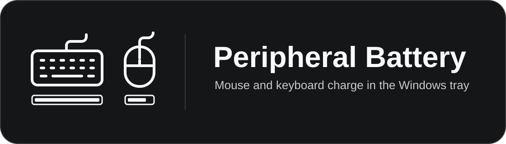

<div align="center">
  
</div>

# Peripheral Battery

Peripheral Battery puts a mouse icon and a keyboard icon in the Windows system tray. Each icon has a charge bar. Hover over an icon for the exact percentage, or right-click either icon to see all detected devices.

## Get started

1. On Windows 10 or 11, open PowerShell in the project folder and run `.\Build.ps1`. The script uses the Windows .NET Framework C# compiler and creates `PeripheralBattery.exe` in the same folder.
2. Open `PeripheralBattery.exe`. The app runs in the system tray.
3. If the icons appear behind the taskbar arrow, drag them from the hidden-icons menu onto the visible tray. On Windows 11, you can also enable both `PeripheralBattery.exe` entries under **Settings → Personalization → Taskbar → Other system tray icons**.
4. Right-click either icon to customize which tray icons stay visible (e.g. show only Mouse icon, show Keyboard icon, or auto-hide icons without battery) and check/uncheck devices. Preferences are saved automatically to `settings.ini`.

## Keep the mouse battery reading fresh

Leave the app running. It checks battery levels every **60 seconds**. For 2.4 GHz receivers (such as the **NACODEX NJ07 MC** or **AJAZZ AJ159 PRO**), move the mouse to wake it, then right-click the mouse tray icon and select **Refresh battery levels**. After charging, use the mouse briefly before refreshing so the receiver has a chance to report a new level.

| Tray status | Meaning |
| --- | --- |
| `81%` | The device or receiver supplied a usable battery reading. |
| `81% (last reported)` | The receiver retained an earlier value, or the app reused the last valid reading from the current session. The actual charge may have changed. |
| Dash inside the bar | No usable battery reading is available yet. |

Polling can only show a new percentage when the device or receiver makes fresh battery data available. The bar is approximate. Hover over it for the exact value. When multiple devices of the same type are detected, the bar shows the lowest available reading.

## Device compatibility

- **Bluetooth:** Uses the battery percentage Windows exposes for the device.
- **2.4 GHz:** Uses Windows' reported battery level where available. The app queries the battery status interface on supported AJAZZ and Attack Shark receivers with USB ID `3151:402D`, as well as NACODEX / YJX receivers with USB IDs `A8A5:2167`, `A8A4:2167`, `A8A5:2168`, etc. (e.g. NACODEX NJ07 MC, NJ08 MC). Other proprietary receivers may require model-specific support.
- **USB:** Shows a percentage when Windows reports one for a rechargeable peripheral. Battery-free wired devices have no charge level.

### Tested device list

| Device | Category | Connection | Hardware ID / USB ID | Support Status |
| --- | --- | --- | --- | --- |
| **NACODEX NJ07 MC** | Mouse | 2.4 GHz receiver / USB | `A8A5:2167` / `A8A4:2167` | Verified working (live % + charging) |
| **NACODEX NJ08 MC** | Mouse | 2.4 GHz receiver / USB | `A8A5:2168` / `A8A4:2168` | Supported (YJX protocol) |
| **AJAZZ AJ159 PRO** | Mouse | 2.4 GHz receiver | `3151:402D` | Verified working |
| **AJAZZ AJ179 PRO** | Mouse | 2.4 GHz receiver | `3151:402D` | Verified working |
| **Attack Shark R3** | Mouse | 2.4 GHz receiver | `3151:402D` | Verified working |
| **AJAZZ AK820** | Keyboard | Bluetooth | Bluetooth LE | Verified working |
| **Standard Bluetooth Mice & Keyboards** | Mouse / Keyboard | Bluetooth | Any | Supported (via Windows battery API) |


## Diagnostics

To print the detected devices and their battery status from PowerShell, run:

```powershell
.\Build.ps1 -Console
.\PeripheralBattery-Diagnostics.exe --list
```

The output lists each device's type, name, connection, and battery status. Keep the mouse awake in its current connection mode when collecting diagnostics. Both build outputs are ignored by Git.

## References

- [Windows notification area](https://learn.microsoft.com/en-us/windows/win32/shell/notification-area)
- [Windows device battery property](https://learn.microsoft.com/en-us/windows/win32/properties/props-system-devices-batterylife)
- [Rongyuan receiver status report](https://github.com/qu1ncky/BatteryTray#how-it-works)

